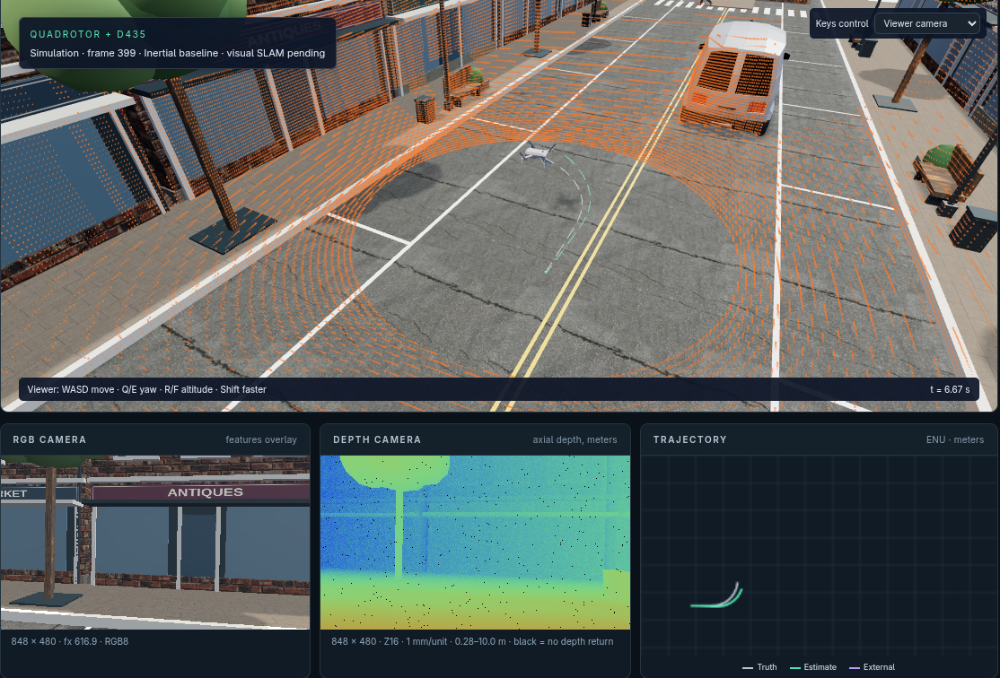

# SLAM Lab

An open source UAV lab that runs in your browser. Explore a simulated city, see
what a drone's sensors see, and edit the math behind its motion, all without
installing a robotics stack.

[**Open the browser demo →**](https://cognipilot.github.io/slam_web/) · [Source on GitHub](https://github.com/CogniPilot/slam_web)

[](https://cognipilot.github.io/slam_web/)

[](https://cognipilot.github.io/slam_web/)

Wait for **Run** to become available, then click it. No setup or initial
**Apply & reset** is needed.

The flight tour and live depth image work in the default inertial demo.
If your browser uses CPU software rendering, a visible warning explains the
automatic lightweight preview. Hardware rendering keeps the native sensor sizes.

## Why use it?

- **Start with a link.** Students and collaborators can open the same lab across
  desktop platforms, without installing Python, containers, or local services.
  Economical graphics with 424 × 240 RGB-D at 5 Hz and airframe IMU at 10 Hz
  is the default on every device. Phones also get a compact layout.
- **See through simulated sensors.** Three.js uses the GPU to render RGB camera
  images, depth images, and an optional 64-beam LiDAR scan. Camera noise and depth
  quantization also run in shaders.
- **Edit the math where it runs.** Change Modelica physics and estimator source
  in the browser, with Rumoca language tools and WebAssembly execution.
- **Understand the whole pipeline.** Inspect the Modelica source for computer
  vision, feature matching, Kalman filtering, mapping, loop closure, and physics
  in one workspace. Students can follow how the pieces fit together and compare
  algorithms as the full SLAM runtime is integrated.
- **Control the experiment.** Adjust camera resolution, sensor rates, lighting, graphics quality,
  cars, and pedestrians. Lockstep timing keeps physics and sensor processing
  synchronized even when an experiment runs slower than real time.
- **Keep your work.** Save projects locally, export them to a file, and reload
  them with their edited source and settings.

## Try it

Start with manual flight and a drone-follow camera; the toolbar switches to an
automatic flight tour. Choose camera views with **V** or **Configuration**.
Enable a second drone there, switch control and follow target in the toolbar,
and add signals from either drone to the live **Plot** pane. Choose
**Big city · furnished interiors** to explore a market, loft, and conference room.
Open **Editor** to inspect or edit Modelica source.

Choose a model from **Run model**. The default is `SLAM.Examples.InertialOnly`;
the responsive and smoothed variants demonstrate the IMU filter tradeoff.
Use **Files** to browse and edit the Modelica library. The viewer and editor
can each collapse or fill the screen without losing your work.
**Docs** shows Modelica package help and components. **Assistant** can find and
read files, edit Modelica with an undoable diff, check compilation, and run up to
30 lockstep frames per request to inspect the results. It can read the map's
room coordinates and edit a flight mission, for example “Start in the store
and fly around inside”, then start normal playback. Mission math stays in
Modelica. Choose OpenAI (Responses
API), a compatible endpoint, local Ollama, or **WebLLM** on your device's GPU.
WebLLM needs WebGPU and about 1–2 GB of GPU memory; its first use downloads and
caches model weights. It has no API billing and pauses simulation while working.
Small local models are best for simple questions and small edits. Remote
providers receive source only when requested by tools; credentials stay in page
memory. Requested edits can apply directly with **Undo edit**; suggested changes
are proposed for review. Generated missions still need inspection and testing.
The app includes a pinned local copy of [CogniPilot Modelica Models](models/Libraries/README.md),
including the position, attitude and body-rate controllers that drive the drone's motors.

Use **WASD** to move the viewer, **Q/E** to turn, and **R/F** to change altitude.
Hold **Shift** to move faster. On a phone, scroll below the viewer for controls
and the editor. Performance depends on the device and selected settings.

**Current status:** Quadrotor physics, inertial propagation, GPU sensor rendering,
and project persistence run in the browser. The complete Modelica SLAM model
(feature detection, mapping and loop closure) runs as compiler-exported native
WebAssembly programs when **Configuration, Flight, Estimator** is set to
**Native Modelica SLAM**. It needs a desktop browser with hardware rendering,
hundreds of MB of memory per drone, and can run slower than real time; the site must
also publish the exported programs (see [Deployment](docs/guides/deployment.md)).
The inertial baseline remains the default. This is a prototype for teaching and
experimentation.

Open **Parameters** for the **Model parameters** inspector. Choose a model, then
expand component groups or search names and descriptions. It includes vehicle and
controller gains, inertial estimation, sensors, scene actors, evaluation and RGB-D
SLAM settings. Controls use Modelica types, units, limits and source defaults;
arrays and record fields appear individually. **Modified only** finds your edits,
and **Restore model defaults** prepares a draft until you apply it. Final and
unsupported structural expressions link back to the Modelica source.

**Apply & reset** recompiles ordinary models so dependent parameters and equations
are updated. For RGB-D SLAM, **Apply parameters** pauses at a completed frame and
retains the current map. Settings save with the project. The SLAM groups include
loop retrieval, geometric verification, pose consistency, keyframe capture and map
maintenance. Calibrated residual mode uses the normalized gate; metric distance/RMS
limits apply when that mode is disabled. The **Loop closures → Candidate decisions**
view shows reference/current images, measured match statistics and Modelica
rejection reasons, with filters for committed and rejected candidates. Passing
geometric verification alone does not mean a loop edge was committed.

The inertial example selector lives under **Configuration → Flight**. It lists
estimator examples and models in your main source; vehicle and motor dependencies
are kept out of that menu. RGB-D SLAM uses the native model selected by its camera
resolution.

## Performance and portable deployment

Modelica describes the mathematical problem. Rumoca compiles that description
and can optimize the connected math across component boundaries. Our goal is to
let algorithms stay readable while the compiler adapts their execution to the
available hardware. Hardware scheduling can evolve without being baked into
each algorithm's implementation.

We plan to package the pipeline as a downloadable **FMU** using the emerging
[FMI-LS WebAssembly format](https://github.com/modelica/fmi-ls-wasm), so the same
math can run in the browser and on a real machine with a compatible runtime and
hardware interfaces. We also plan to optimize **CPU and GPU execution** for
these FMUs. Complete SLAM FMU export and robot deployment remain roadmap work;
today's demo ships browser WASM assets.

## Develop locally

Maintainers can use the reproducible [Nix environment](flake.nix):

```sh
nix develop --no-update-lock-file path:.#ci
npm ci
npm run assets
npm run dev
```

`npm run dev` and `npm run build` initialize the pinned `modelica_models` Git
submodule automatically. Git and network access are needed on the first build;
visitors receive the sources in the static site and need neither.

`npm ci` installs the published Rumoca **0.10.3** browser compiler from npm,
using the exact version and integrity in `package-lock.json`. The postinstall
check verifies the JS/WASM pair and embedded compiler revision against
[rumoca-package.json](rumoca-package.json); it refuses a different version,
revision or file hash. This release path needs no GitHub login or Actions token.
Set `RUMOCA_WASM_PACKAGE` to an existing copy of that exact package to verify
and install it without a separate compiler download.

The precompiled native SLAM kernels have their own immutable pin in
[slam-native-package.json](slam-native-package.json). They retain their recorded
compiler revision until regenerated and qualified; updating the browser compiler
does not rewrite these kernels or transfer earlier performance/accuracy results.

`npm run build` produces a static site. GitHub Actions deploys it to Pages after
the supported demo's CI checks pass on `main`.

[User guides](docs/README.md) · [Modelica library](https://github.com/CogniPilot/modelica_models)

## License

Copyright 2026 Cognipilot. Licensed under [Apache 2.0](LICENSE); see [NOTICE](NOTICE).
Third-party models, textures, and dependencies retain their own licenses and
[asset credits](public/models/licenses/ACTORS.md).
