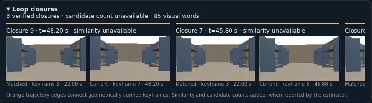

# Hosting and deployment

SLAM Lab builds into a static website. Simulation and compilation run in the
visitor's browser using WebAssembly; no simulation or compiler service is needed.

## Build the website

Use the pinned Nix environment:

```sh
nix develop --no-update-lock-file path:.#ci
npm ci
npm run assets
npm run build
npm run preview
```

The build initializes the pinned `modelica_models` Git submodule automatically.
It needs Git and network access once; subsequent builds reuse that checkout.

Publish the contents of `dist/` to a static host. This repository deploys to
GitHub Pages after CI passes on `main`. The deployed site includes the compiler,
Modelica source and rendering assets.

`npm run assets` installs the verified native SLAM package pinned in
`slam-native-package.json` when its source hash matches the checkout. Existing
local exports from older revisions do not override that delivery.

`SLAM_NATIVE_EXPORTS` or `--exports` selects local Rumoca `native_step` exports
of `D435FastSLAMInitialize` and `D435FastSLAMStep`, with `init-named` and
`step-named` directories. When edited sources differ from the package pin,
the publisher looks for matching exports in
`~/scratch/slam_web/build/slam-native-profiles` when its 424 × 240 profile exists,
otherwise the legacy `slam-native-exports` directory.
The programs are content addressed, gzip compressed and listed in
`public/vendor/slam/manifest.json` together with the SLAM source hash they were
compiled from. An explicitly selected missing export directory leaves the
estimator unpublished, or fails the build with `--require`.

The immutable release in `slam-native-package.json` contains all five modes.
The installer verifies the archive hash, source composition and input dimensions,
and caches the download in
`~/scratch/slam_web/downloads/native-slam`. This also supplies native SLAM to
the Pages build. Set `SLAM_NATIVE_PACKAGE` to that exact archive for an offline
install. Explicit `SLAM_NATIVE_EXPORTS` overrides still require local exports;
edited Modelica sources require new compiler exports.
`node scripts/slam-native-assets.mjs --package` selects the pinned delivery
explicitly, even on a development machine that already has local exports.

The resolution selector offers the ordinary sizes shared by D435 RGB and Z16
depth: 424 × 240, 640 × 360, 640 × 480, 848 × 480 and 1280 × 720.
The 720p pair supports at most 30 Hz; the other pairs support 60 Hz.
New projects start at 424 × 240. Saved projects without a resolution retain
848 × 480. These are simulated pinhole optics, not device-specific calibration.
[D400 datasheet, Table 4-2](https://realsenseai.com/wp-content/uploads/2025/08/Intel-RealSense-D400-Series-Datasheet-August-2025.pdf).

Export matching native programs for every camera size using a built Rumoca
`native_step` executable and the Modelica Reset state CSV:

```sh
node scripts/export-slam-profiles.mjs --binary /path/to/native_step --reset /path/to/reset.csv --revision COMPILER_COMMIT
node scripts/slam-native-assets.mjs --require
```

Exporters with binary Reset support can instead use `--reset-bin state_init.bin
--state-hash NAMES_HASH`. The binary must contain source-owned Reset values in
the compiler's sorted state-name order. The exporter verifies the name hash and
exact scalar count before using it, avoiding a large intermediate CSV.

`--output` changes the scratch export directory; `--resolution 424x240` exports
one mode. Each profile records the executable hash, exact source, compiler
revision supplied by the caller and export commands. The wrappers change image
dimensions only; feature, keyframe and map capacities remain unchanged. Changing
resolution resets the experiment and loads its matching programs. Missing
profiles produce an explicit error instead of resizing captured images.
SLAM's raw arrays and FAST loops derive their bounds from the selected image
dimensions; keyframes retain the actual `rgbSize` and `depthSize`. The legacy
848 × 480 entrypoints are defaults only. The host writes resolution-specific
RGB/depth intrinsics and noise calibration for every image. The publisher checks
both exported programs' input counts against the selected raster.
The smallest raster and lower rates trade visual information for throughput;
the initial city view can contain too few features for mapping at 424 × 240.
Use a larger size when comparing localization or map quality.

To measure the complete native run, serve a production build and run
`node scripts/profile-native-slam.mjs`. Results and screenshots go to
`~/scratch/slam_web/profiles/browser-native-slam`. Set `CHROMIUM_PATH` if needed;
`SLAM_PROFILE_URL`, `SLAM_PROFILE_RESOLUTION`, `SLAM_PROFILE_CAMERA_HZ`,
`SLAM_PROFILE_IMU_HZ` and `SLAM_PROFILE_FRAMES` select the experiment.
`SLAM_PROFILE_CPU_PROFILING=1` also records Chrome CPU profiles for the main
thread and every worker. Profile sampling adds overhead; measure throughput
separately with it disabled. `attribution.json` groups weighted self samples
into WASM, JavaScript (including TypeScript, libraries and generated glue), GC
and native/unattributed time, with the hottest functions per worker. Idle time
is excluded; these percentages do not measure GPU utilization or wall time.

`SLAM_PROFILE_SESSION_TIMING=1` records `session-timing.json`, separating actual
Rumoca API calls (`advance_to`, input updates and state serialization), worker
receive-to-send time and RPC wall time. These intervals overlap; do not add them.
`SLAM_PROFILE_EXECUTION_RECEIPT=1` records the physics compiler revision and its
execution receipt before and after measurement. To compare another browser
compiler without changing deployed files, set `SLAM_PROFILE_COMPILER_DIR` to a
directory containing its paired JS/WASM bindings; their hashes are recorded.

A sampled run on an RTX 3090 with Chromium 154 (15 Hz camera, 90 Hz IMU,
848 × 480; ten warmup frames and sixty measured frames) attributed 85.2% of
active self samples to WASM, 6.8% to JavaScript, 0.8% to GC and 7.2% to browser
bindings/unattributed time. JavaScript accounted for 1.1% within the native SLAM
worker and 1.2% within physics. This used Rumoca `9f507597` for both native
exports and the browser compiler; production browser bindings remain separately
pinned in `rumoca-package.json`. The largest physics cost was typed-program
evaluation inside WASM; SLAM's large State publication was another hotspot.
An uninstrumented production build with the existing browser compiler pin,
424 × 240 at 5 Hz and a 10 Hz IMU ran 12 simulated seconds in 13.68 wall seconds
(0.88× realtime). Mean frame work was 175 ms physics, 45 ms native SLAM and
6.5 ms sensors. Realtime is not yet achieved; the lower raster trades away
visual features, and this throughput check does not qualify localization accuracy.

A follow-up profile of app `559a0ff`, Modelica `d2ebf66` and the deployed browser
compiler `2aaed750` on October 14, 2026 measured the following warehouse circuit.
The shared host used a Ryzen 9 5950X, RTX 3090 and Chromium 154. All runs used
424 × 240, Economical graphics, one drone, a 5 Hz camera, no LiDAR or depth-cloud
display, ten warmup frames, and sequential unpaced steps with CPU sampling off.
The 30 Hz run also enabled API timing; host contention makes these measurements
comparisons rather than guaranteed throughput.

| IMU rate | Real-time factor | Frame work | Physics | Native SLAM | Camera capture |
| --- | --- | --- | --- | --- | --- |
| 10 Hz | 0.63× | 319 ms | 237 ms | 74 ms | 5.8 ms |
| 30 Hz | 0.51× | 394 ms | 255 ms | 132 ms | 5.2 ms |
| 90 Hz | 0.30× | 662 ms | 332 ms | 323 ms | 5.2 ms |

A separate 180-frame CPU profile at 10 Hz IMU attributed 90.7% of active self
samples to WASM and 3.6% to all JavaScript. API timing over 90 frames measured
19.73 seconds in physics `advance_to`, 0.47 seconds updating physics inputs,
and 0.18 seconds serializing physics state, across 27.26 wall seconds. Physics
worker receive-to-send time was 20.41 seconds versus 20.45 seconds for its RPCs.
The primary optimization target is physics execution; messaging and TypeScript
are small. Prediction-only native SLAM calls cost about 16 ms per IMU interval,
so high IMU rates also impose a substantial processing floor.

A longer 320-frame run covered 64 simulated seconds at 0.66×, including three
loop edges. Its first and last 60 frames averaged 301 and 305 ms respectively;
the measured slowdown did not grow substantially as the map developed. Mean
work was 227 ms physics, 69 ms native SLAM and 5.2 ms camera capture. This
particular circuit measured 0.33 m position RMSE and 0.73 m maximum error.

Comparing browser compiler `9f507597` with the same app, models and native SLAM
assets measured 0.59×. Its physics receipt reported 33,662 additional declined
whole-expression executions during the measured window, and assignment-schedule
declines for unsupported assertion-predicate outputs, including calls in
`Control.Multirotor.LogLinear`. A compiled engine receipt does not establish
that every physics expression uses compiled execution. This comparison does not
justify upgrading the deployed compiler for speed by itself.

Economical graphics retains explicitly selected sensor rates. In Configuration,
**Use quality defaults** restores 5 Hz camera and 10 Hz IMU while Economical is
selected; camera resolution remains independently selectable. The measurements
above remain below real time at those defaults. Raw profiles are stored under
`$HOME/scratch/slam_web/profiles/current-warehouse-424-*` on the profiling host.

The compiler pin now uses the official PR #436 CI artifact from run
`38657199115`, built at merge revision `5c68a1c67524` (head `383d0f6da6cc` merged
with `ad00214a2294`). The actual browser warehouse run with that exact package
measured **2.04× realtime** over 90 frames at the same 424 × 240 / 5 Hz camera /
10 Hz IMU settings. Physics receipts before and after reported `wasm_program`,
no refusal and zero declined executions. Estimated positions matched the old
compiler exactly. Camera work averaged 9.4 ms and the remaining native SLAM tail
58.6 ms; native SLAM is now the principal throughput limit.

API timing of the equivalent locally built head package measured physics RPCs
at 15.3 ms per camera frame, including 11.0 ms in `advance_to`, 0.7 ms updating
inputs and 0.9 ms serializing state. The graph's physics node also waits for
overlapped IMU prediction, so its wall time must not be described as solver CPU
time. The new pin exceeds realtime on this host; these measurements do not
establish 10× operation or equivalent performance on other computers.

A fresh 30-frame CPU profile with that compiled physics pin and published native
SLAM module `cead2d1d556eeb1f` attributed 64.2% of
active samples to WASM, 9.1% to all JavaScript, 2.6% to GC and 24.0% to browser
bindings/unattributed execution. JavaScript includes libraries and generated
glue; inside the native SLAM worker it accounted for 1.6%. The largest JavaScript
leaf function accounted for 0.47% of all active samples. The top 25 functions,
raw profile hashes and native delivery identity are recorded in
[compiled-browser-cpu.json](../profiles/compiled-browser-cpu.json).
Sampling changes throughput, and these are CPU proportions across threads,
not TypeScript wall time or a predicted speedup.

All browser compiler loaders request the JavaScript and WASM pair with the exact
pinned revision in their URLs. Updating the pin also changes the worker bundles,
so a newly loaded app bypasses cached compiler files from the previous deployment.
The native SLAM manifest URL includes its pinned delivery hash; its program and
state blobs already have content-addressed filenames.

Playback batches completed simulation frames within an 8 ms wall-time budget,
then yields; the 10× selector requests that pace but does not guarantee it.
Every configured sensor event and estimator update still runs. Overview poses,
diagnostic geometry, and DOM updates coalesce at the independent 30 Hz display
deadline; navigation, telemetry, recordings, and comparison samples retain every
measurement. Pause/resume invalidates callbacks from earlier playback runs.
Background tabs suspend display updates with RAF; sensor processing can continue.

For one live drone, held-IMU SLAM predictions now run concurrently with the next
physics interval of the same camera frame. Every prediction is awaited before
camera publication, and the frame's complete IMU prefix is checked against the
already predicted intervals. Replay and paired-drone barriers retain serial
execution. `SLAM_PROFILE_OVERLAP=0` selects serial execution for comparisons.

A sequential 30-frame warehouse comparison at 90 Hz IMU measured 0.212× serial
and 0.319× streamed prediction under host load. Physics means were 501 and
547 ms per camera frame; the serial SLAM tail fell from 431 to 71 ms while total
native SLAM work remained 428–469 ms. Every recorded truth field, estimated
position, and non-timing diagnostic matched exactly. These are shared-host
observations, not a 10× throughput qualification.

For browser-only native-program experiments, `SLAM_PROFILE_NATIVE_DIR` can point
to a directory containing replacement published asset filenames. Files absent
there use the served delivery. The profiler records overridden file hashes in
`native-comparison.json`, plus separate overview and UI submission means in the
report. Keep the compiler and native-program overrides independent.

Set `SLAM_PROFILE_STATE_HASH=1` to hash every carried SLAM state cell after the
timed window. `native-state.json` records a SHA-256 over canonical named runs,
including their names, lane types and counts. Compare it between compiler-only
exports with the same model, inputs and frame count to check exact final state
equality. The capture only observes the actual native worker's imported memory.

To clock selected functions inside a stripped native Step module, first rewrite
a diagnostic copy with `scripts/instrument-native-slam.mjs --out DIRECTORY
--functions ID,ID,...`, then run the browser profiler with
`SLAM_PROFILE_NATIVE_DIR=DIRECTORY SLAM_PROFILE_NATIVE_TRACE=1`. Function IDs must
come from that exact module. The tool records original and instrumented hashes;
the profiler emits `native-function-timing.json`. The injected timers are never
part of a normal app build. Inclusive times overlap; selected-exclusive times
exclude only the other instrumented descendants.

For module `cead2d1d556eeb1f` at 424 × 240, instrumenting IDs
`472,582,588,591,613,614,615` over 30 warehouse frames with 10 Hz IMU measured
77.5 ms total native work per camera frame. Function 472 accounted for 42.2 ms;
582 and 588 accounted for 3.4 and 7.6 ms. Outer functions 614 and 615 added
14.5 ms outside the other instrumented functions. All ran twice per frame,
including IMU-only calls. A compiler symbol map is needed to establish source
names. Re-exporting at PR #436 produced byte-identical modules and recovered the
exact map: 472 is `RGBDLocalizationProcessing.Publish`, 582 is
`SelectRasterFeatures`, and 588 is `FastFrameScores`. Their combined detection
and selection cost is 11.0 ms per camera frame; publication costs 42.2 ms over
two interval calls, not 42.2 ms per call. The named timing evidence is retained in
[native-slam-424-hotspots.json](../profiles/native-slam-424-hotspots.json).
Instrumented and original modules produced identical positions.

A separate browser-only override tested the compiler liveness change on the
same Modelica main source, using exporter revision
`54a38ac8e9668f17c4ae566fcc6d2cc44adc0b77-liveness` and native module
`a35dfdb7f9879af7`. This unpublished delivery measured publication at 33.0 ms per
camera frame, including 20.3 ms in its catalog-publication child and 12.2 ms
outside the instrumented children. The parent-edge costs, exporter binary hash,
overridden asset hashes and full source spans are retained in
[native-slam-424-publish-hotspots.json](../profiles/native-slam-424-publish-hotspots.json).
These costs describe that experimental override; the pinned delivery above and
Modelica PR #18 have separate identities. Shared host load prevents treating
these runs as a controlled speed comparison.

An October 14 shared-host experiment on the existing 424 × 240 native Step
module with Binaryen 129 `wasm-opt -O3 --all-features` produced identical truth
and estimate positions over 30 warehouse frames. Native SLAM means changed
from 76.5 to 72.2 ms, while unchanged physics varied from 264 to 250 ms; this
does not establish a speedup. The optimizer experiment is not deployed.

## Warehouse tracking regression

The toolbar shows the active estimator. New projects currently start with the
inertial baseline, which performs no visual mapping or loop search. For the
desktop RGB-D demonstration, choose **Configuration → Estimator → Native
Modelica SLAM**, select the warehouse and 424 × 240, and run a returning path.
The independent overview targets 30 FPS even when simulation runs slower.

The Loop closures panel retains small copies of actual keyframe RGB samples,
including initialization at time zero. It associates images through the model's
stable keyframe IDs and image epochs, keeps at most 128 thumbnails and six
closure cards, and shows matched/current timestamps. Orange edges on the map
are verified loop constraints. Unreported retrieval counts and similarity scores
are displayed as unavailable; a best retrieval score is not substituted for the
score of a geometrically accepted edge.

A 50-second warehouse circuit produced three verified edges at 43.8, 45.8 and
48.2 simulated seconds, matching retained keyframe 3 at 22.0 seconds with
keyframes 5, 6 and 7. All estimated positions matched the earlier serial circuit
exactly. Under host load it measured 0.49× with a 30 FPS overview and no browser
errors; it does not qualify 10× realtime simulation.



`DESKTOP_NATIVE_DEFAULT` in `src/estimator-default.ts` is prepared but disabled.
When enabled, it considers only fresh projects with hardware graphics, a
non-mobile browser, SIMD, at least 8 GB reported device memory and eight logical
cores, and a published native camera profile. Missing capabilities, unknown
memory, unpublished assets or failure of this automatic startup retain/fall back
to inertial. Saved estimator choices remain explicit. This backend does not
require shared-memory threads or cross-origin isolation.

The native camera image is consumed at its capture boundary, after every
preceding held IMU interval. Calibrated RGB-D registration refines the geometric
seed using each point's covariance and reports uncertainty from the same
weighted normal matrix. Reduced rasters retain lower-contrast FAST corners;
the correspondence, inlier and geometric verification requirements remain.

Production keyframe admission screens consecutive edges and retrieved loops
against estimated motion. It combines retained pose and measurement uncertainty
conservatively and defaults to a 2 m translation-disagreement limit. This
prevents a repeated warehouse shelf bay from pulling the map into another bay.
The stateless geometric verifier remains independent of estimated poses;
explicit relocalization callers can change the admission policy. Native
keyframes, verified loop edges and covariance now appear in the viewer.

The hardware browser regression runs a fixed-heading warehouse circuit with
424 × 240 RGB-D at 5 Hz and an IMU at 10 Hz. It requires a corrected loop,
position RMSE below 0.6 m and maximum position error below 1.2 m. The longer
64-second indoor out-and-back validation measured 0.37 m RMSE, 1.04 m maximum
error and five loop edges. These are synthetic warehouse checks, not a general
accuracy qualification for real camera data or every scene.

The indoor Modelica tour waits two seconds for settling, then repeats a 6 m
out-and-back route inside the enclosure. Start a new project to load updated
physics sources; saved projects retain their editable source.

```sh
SLAM_PROFILE_ENVIRONMENT=warehouse SLAM_PROFILE_TOUR=indoor \
  SLAM_PROFILE_FRAMES=320 node scripts/profile-native-slam.mjs
```

The report includes position error against the Modelica evaluation reference,
keyframe/loop counts and runtime diagnostics. `SLAM_PROFILE_TOUR=warehouse-loop`
selects the smaller circuit used by the browser regression.

## Running on a robot

The Modelica library is maintained independently in
[CogniPilot Modelica Models](https://github.com/CogniPilot/modelica_models).
**Download SLAM FMU** in the Embedded deployment panel serves the FMI-LS
WebAssembly package of `D435FastSLAMStep` (FMI 3 co-simulation,
`binaries/wasm32-wasip2/` component, `modelDescription.xml` with Int64 Integer
and Boolean variables) when the site publishes it. `npm run assets` copies
`package/published/D435FastSLAMStep.fmu` from the export directory next to the native
programs. The package is the compiler's current build (about 7 MB zipped, a 28 MB
component): functionally complete, but not yet wired to CPU/GPU execution
planning or hardware sensor interfaces on a host.
The header **Download** button still exports the project, not the FMU.
